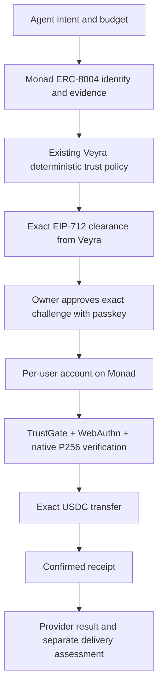

# Veyra on Monad — Metropolis implementation spec

Status: local implementation and publication of the read-only `/metropolis`
diagnostic on the existing Veyra domain authorized on 2026-10-08. Contract
deployments and spending still require separate approval.
Starting commit: `3b0a29e780b83246509d54638567c3c2dc6c6cbb`.
Branch: `metropolis-monad`. Network for the demo: Monad Testnet, chain ID 10143.

## Product

Veyra evaluates an agent's proposed purchase using identity, evidence, risk and
spending policy. The owner separately approves the exact payment with a passkey.
Monad verifies the policy clearance and the WebAuthn assertion before USDC moves.

The existing trust engine and TrustGate predate this integration. The new work is
the isolated Monad adapter, per-credential account/factory, WebAuthn authorization,
relayed payment path and focused demonstration. Existing Arc execution remains
unchanged. Autonomous spending stays frozen.

## Boundaries



- Reuse `VeyraTrustGate.sol` unchanged and its EIP-712 domain/schema.
- Each user has a CREATE2 account with an immutable P256 public key, RP ID hash,
  origin, USDC address and TrustGate. No generic calls, approvals or delegatecall.
- The initial execution action is only `USDC.transfer(counterparty, requestedAmount)`.
  The account constructs this call itself and checks its hash against the clearance.
- `executor` is the account. `subject` retains its meaning as the trust subject;
  it must not silently be reinterpreted as the relayer or account owner.
- Bind the human challenge to chain ID, account, TrustGate, clearance digest,
  transfer action hash, nonce and deadline. Enforce clearance issuance/expiry,
  maximum amount, user presence and user verification. Use the account nonce for
  replay protection; synchronized passkeys may have a zero signature counter.
- OpenZeppelin 5.6.1 `WebAuthn.verify` handles assertion checks. The account adds
  RP ID and origin restrictions and requires `P256.verifyNative`; a Solidity
  fallback alone does not satisfy the Monad demo acceptance criterion.
- The first prototype accepts the compact browser client-data JSON format with
  `crossOrigin:false`. Other encodings fail closed and need explicit compatibility
  tests before being supported. Do not write a permissive custom JSON parser.
- The relayer submits EVM transactions and pays MON. USDC resides in the user's
  account. Estimate MON gas with Monad semantics; fees are charged on the gas limit.
- No recovery, key rotation or general-purpose wallet claims in this prototype.

## Passkey domain

The owner selected `/metropolis` on the existing Veyra domain. The canonical
origin is `https://agent-commerce-six.vercel.app`, with RP ID
`agent-commerce-six.vercel.app`. An RP ID is a hostname, not a URL path.
Changing the hostname requires registering a new credential. Preview hosts and
the alternative Vercel alias are rejected. `localhost` is allowed for development;
its credentials cannot authorize a production-origin account.

The local `/metropolis` page registers a credential using viem and performs a
domain-separated diagnostic signature check via the native precompile. This is
not the payment challenge and cannot authorize a payment. Only public credential
metadata is stored in the browser. The page does not mount the Arc wallet provider.

## Verified sources (2026-10-08)

| Parameter | Monad Testnet | Monad Mainnet (read-only configuration) |
| --- | --- | --- |
| Chain ID | 10143 | 143 |
| RPC | https://testnet-rpc.monad.xyz | https://rpc.monad.xyz |
| Native gas asset | MON | MON |
| USDC, 6 decimals | `0x534b2f3A21130d7a60830c2Df862319e593943A3` | `0x754704Bc059F8C67012fEd69BC8A327a5aafb603` |
| Identity Registry | `0x8004A818BFB912233c491871b3d84c89A494BD9e` | `0x8004A169FB4a3325136EB29fA0ceB6D2e539a432` |
| Reputation Registry | `0x8004B663056A597Dffe9eCcC1965A193B7388713` | `0x8004BAa17C55a88189AE136b182e5fdA19dE9b63` |
| P256 | `0x0100`, EIP-7951 | `0x0100`, EIP-7951 |

Sources: [Monad current facts](https://docs.monad.xyz/ai/current-facts),
[precompiles](https://docs.monad.xyz/developer-essentials/precompiles),
[block states and RPC commitments](https://docs.monad.xyz/monad-arch/consensus/block-states),
[Foundry](https://docs.monad.xyz/tooling-and-infra/toolkits/foundry),
[ERC-8004 deployments](https://github.com/erc-8004/erc-8004-contracts),
[Circle USDC addresses](https://developers.circle.com/stablecoins/usdc-contract-addresses).
Confirm RPC chain IDs, contract code, USDC decimals and the reputation registry's
identity-registry reference before using an adapter. Precompiles have no bytecode;
verify a real known signature instead of testing `eth_getCode(0x0100)`.

Use official Foundry >=1.8 with `--network monad` or `network = "monad"` in
the isolated config. Never install the deprecated Category Labs Foundry fork.
MONSKILLS are navigation aids, not a source of truth for addresses or live gas
parameters. Reviewed upstream: `3f8efd26057985d46e5b2b3b611c7e6957fadee0`.
Skills and Context7 setup remain local and excluded from Git.

## Monad trust backend

`lib/monad/evidence.ts` collects verified facts through read-only RPC. Trust
collections use one `finalized` block for identity, token and registry reads;
Monad's `latest` represents a proposed block. Payment evidence must reference
a successful, canonical USDC `Transfer` log at or before that finalized block,
with at least two confirmations measured against the finalized height. The
historical block hash, recipient, payer, exact amount and log index are checked.
Provider self-transfers and provider-controlled feedback addresses are excluded.

ERC-8004 feedback enters scoring only for explicit operator-selected clients and
the local convention `tag1=veyra.delivery`, `tag2=score100`, decimals zero, value
0..100. This is a Veyra convention, not an ERC-8004 requirement. Raw registry
values, review count and distinct addresses do not establish independent ownership
or verified delivery. Missing/unconfigured feedback stays missing.

Delivery assessments carry an EIP-712 signature from an operator-configured
non-provider reporter. They bind agent, buyer, seller, payment transaction and
amount, request/response hashes, score, verdict and timestamp to Monad Testnet.
The registry address namespaces the offchain report; the registry does not store
or validate the report. Assessments require an unambiguous previously verified
payment. Unsigned, conflicting, future-dated and mismatched reports are rejected.

`lib/monad/trust.ts` reuses the existing `computeAgentReputation` and `resolvePolicy`.
The pure scoring input now accepts Monad identity and the explicit evidence types
`usdc_payment_success` and `service_delivery`. It does not manufacture x402 events,
ERC-8183 jobs or Arc proofs. Existing Arc scoring inputs and thresholds retain
their behavior. Veyra confidence is a category-coverage heuristic, not a calibrated
probability. A single operator report can describe execution and service quality;
those dimensions are not two independent evaluators.

Additional Monad execution checks require corroborated payment and passed delivery
history, no failed delivery assessment, a fresh collection, a matching canonical
payee, an executable trust tier and an amount within both owner budget and tier cap.
Old source timestamps cannot be refreshed by rereading identity. Amounts are exact
decimal strings with at most six places and become atomic integer USDC units.
The first account cannot execute `REQUIRE_EVALUATOR`; these cases require review.

Evidence and decisions are deeply immutable and retain process-local verification
provenance. A browser-supplied score or serialized/copied decision cannot reach the
clearance issuer. Recompute through the server collector after a process restart;
do not deserialize a client packet into an authorized decision. Policy client,
reporter and payment lists are operator configuration, not trusted HTTP input.

The Monad clearance builder reuses the original EIP-712 schema and binds the exact
canonical USDC transfer. Task/service, owner budget and evidence are bound into
the decision identifier. Passkey challenges match the Solidity account's nonce,
deadline, domain and digest. Candidate selection shares one task/executor/budget,
filters by executable policy first, then orders by trust or price. Shared onchain
ownership is disclosed. Selection never promises independent providers.

These are backend primitives and verification scripts. A public signing endpoint,
production attester/relayer configuration, device account deployment, fresh
identity/account checks before submission and order/delivery persistence are not
enabled yet. The browser diagnostic remains read-only. No first-time purchase
override or autonomous wallet has been introduced.

## Milestones and acceptance

1. **Local safety prototype:** account + factory; generated cryptographic WebAuthn
   fixtures; valid transfer; wrong key/RP/origin/flags/amount/recipient/nonce,
   expiration, unauthorized attester/executor and clearance replay tests. Check
   rollback on failed token transfer. Run existing Arc contract tests unchanged.
2. **Live read/fork checks:** RPC smoke on both chain IDs; canonical testnet
   ERC-8004 relationship and token checks; real P256 `eth_call`; reproducible
   Monad fork test. These do not establish a deployed payment transaction.
3. **Actual device prototype:** fix a dedicated HTTPS origin and RP ID before
   registration. Create a real iPhone/browser credential, extract its P256 key,
   normalize DER/low-s, and verify the assertion through the deployed account.
   Record a transaction receipt. No Face ID success claim before this passes.
4. **Trust integration:** reuse the existing policy resolver with honest Monad
   evidence. The current full decision service has Arc-specific proof/database
   assumptions; do not invent an Arc proof to make a Monad candidate pass it.
   Distinguish Veyra score from ERC-8004 feedback values and disclose evidence
   coverage and provenance. Missing evidence must remain missing.
5. **One useful purchase:** selected agent, exact clearance, human approval,
   confirmed USDC transfer, actual service result, request/response hashes and
   a separate delivery assessment. Payment success is not delivery success.
6. **Feedback and demo:** verify the deployed ABI before supporting a separate
   passkey-authorized reputation action. The published ABI is
   `giveFeedback(uint256,int128,uint8,string,string,string,string,bytes32)`.
   Feedback must come from the client account after a real interaction; never
   fabricate favorable reviews. Disclose self-created demonstration agents.

The main demo excludes x402, Gateway and the full ERC-8183 lifecycle. Add them only
after the principal flow passes. A bare USDC transfer does not provide escrow or
guarantee that the provider delivers; the demo must say so accurately.

## Approval gates

Before each external deployment/transaction present the concrete network,
contract/action, recipient, amount and estimated gas cost. No mainnet writes.
Before publishing review the explicit file list; private planning documents,
local skills, local MCP configuration, secrets and build artifacts must be absent.

### Public change manifest

The new public implementation files are:

```text
app/metropolis/page.tsx
app/metropolis/prototype.tsx
contracts/monad/foundry.toml
contracts/monad/test/MonadPrecompileFork.t.sol
contracts/monad/test/VeyraPasskeyAccount.t.sol
contracts/monad/test/fixtures/backend-clearance.json
contracts/monad/test/fixtures/webauthn.json
contracts/src/monad/VeyraPasskeyAccount.sol
contracts/src/monad/VeyraPasskeyAccountFactory.sol
docs/METROPOLIS.md
lib/monad/config.ts
lib/monad/erc8004.ts
lib/monad/evidence.ts
lib/monad/passkey.ts
lib/monad/trust.ts
scripts/metropolis/browser-smoke.mts
scripts/metropolis/generate-webauthn-fixtures.mts
scripts/metropolis/rpc-smoke.mts
scripts/metropolis/trust-smoke.mts
scripts/metropolis/trust-tests.mts
```

Modified existing public files: `.gitignore`, `.vercelignore`, `AGENTS.md`,
`components/layout/layout.tsx`, `lib/reputation/engine.ts`, `lib/reputation/types.ts`.
Fixture keys/receipts/identities are explicitly synthetic; no real wallet secret
is included. `MonadPlan.md` is excluded from Git and deployment uploads. Local
MCP setup, MONSKILLS and Foundry binaries are excluded from deployment uploads.

## Evidence

No Metropolis contracts have been deployed yet. No spending has been authorized.

Verified locally on 2026-10-08 with official Foundry 1.8.5:

- 37 Monad account/factory tests passed with generated cryptographic assertions.
  No mocked P256 verifier: the tests execute using the Monad network mode.
  Four tests additionally consume a clearance produced by the real TypeScript
  trust pipeline: digest/challenge equality, exact transfer, replay and tampering.
- 53 backend authorization/provenance checks passed using explicitly synthetic
  RPC evidence and real cryptographic report signatures. Tests cover ALLOW,
  ALLOW_WITH_LIMITS, review/deny, owner/tier limits, payee binding, finality,
  duplicate/conflicting evidence, failed delivery, server provenance and selection.
- The existing seven Arc reputation vectors and TrustGate policy tests passed.
- A live read-only trust probe of public Testnet agent #1 at finalized block
  **69224986** returned `REVIEW_REQUIRED`, coverage 17%, no executable clearance.
  Identity-only score 100 does not bypass evidence requirements. This is not a
  demo provider or a purchase/quality assessment.
- 31 existing Arc contract tests passed unchanged with Ethereum execution mode.
- One native-precompile and infrastructure fork test passed at Monad Testnet
  block **69196275**. It verifies both accepted and rejected signatures.
- Read-only RPC checks passed on chain IDs 10143 and 143: contract bytecode,
  USDC decimals, canonical registry relationship, and native P256 acceptance
  and rejection on Testnet. Agent #1 was read only as a public registry example;
  it is not a Veyra demonstration agent or an endorsed seller.
- Browser smoke passed at a mobile viewport using Chromium's virtual WebAuthn
  authenticator and the live Testnet RPC: credential creation, native signature
  verification, public metadata restoration and alternate-host rejection.
  This does not establish Face ID compatibility on an actual iPhone.
- TypeScript, scoped ESLint, `npm run build` and the existing deterministic
  trust-policy test passed.

Reproduce from the worktree root after `npm ci`, with official Foundry >=1.8:

```bash
node --experimental-transform-types --no-warnings scripts/metropolis/generate-webauthn-fixtures.mts
node --experimental-transform-types --no-warnings scripts/metropolis/trust-tests.mts --write-contract-fixture
forge test --root contracts/monad --network monad --no-match-contract MonadPrecompileForkTest -vv
forge test --root contracts/monad --network monad --match-contract MonadPrecompileForkTest --fork-url https://testnet-rpc.monad.xyz --fork-block-number 69196275 -vv
forge test --root contracts --network ethereum -vv
node --experimental-transform-types --no-warnings scripts/metropolis/rpc-smoke.mts
node --experimental-transform-types --no-warnings scripts/metropolis/trust-smoke.mts 1
npm run reputation:test
npm run trust-gate:test
npx tsc --noEmit
npx eslint app/metropolis lib/monad components/layout/layout.tsx scripts/metropolis
```

For the browser smoke, start `npm run dev -- --hostname localhost --port 3123`,
then run `node --experimental-transform-types --no-warnings scripts/metropolis/browser-smoke.mts`
in another terminal. Install Chromium with `npx playwright install chromium` if needed.
All these smoke checks use read-only network calls. Test fixture generation keeps
its ephemeral private key in memory and writes only public signatures/metadata.

Milestones 1 and 2 are complete. Milestone 3 has a local browser diagnostic;
an actual-device assertion through a deployed account and its transaction receipt
are still required. Milestone 4 now has a verified backend foundation and local
contract integration; live service evidence, endpoint wiring, delivery persistence
and client feedback remain separate implementation steps. Existing scripts that send signed onchain
transactions are not acceptance checks for this local phase.
